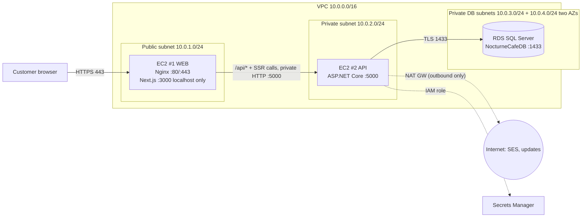

# AWS deployment — 2 × EC2 + 1 × RDS SQL Server

## Architecture


| Security group | Inbound | Source |
|---|---|---|
| **web-sg** (EC2 #1) | 80, 443 | 0.0.0.0/0 |
| | 22 (optional) | your `/32` only — prefer SSM Session Manager (no inbound needed) |
| **api-sg** (EC2 #2) | 5000 | **web-sg only** (no public IP, no 22) |
| **db-sg** (RDS) | 1433 | **api-sg only**, `PubliclyAccessible=false`, DB subnets have no internet route |

Port 3000 (Next.js) is bound to `127.0.0.1`; only Nginx can reach it.

## Option A — one command for the network, instances and RDS
`deployment/aws/infrastructure.yaml` (CloudFormation) creates the VPC, subnets, IGW, NAT, route tables, the three security groups, least-privilege IAM roles (SSM + read of two named secrets), **exactly two EC2 instances** (IMDSv2, encrypted gp3, 2nd volume for uploads) and the **encrypted RDS** instance (private, 7-day backups, deletion protection, Secrets-Manager-managed master password).
```bash
aws cloudformation deploy --stack-name nocturne --template-file deployment/aws/infrastructure.yaml \
  --capabilities CAPABILITY_IAM --parameter-overrides AdminCidr=203.0.113.7/32
aws cloudformation describe-stacks --stack-name nocturne --query "Stacks[0].Outputs"
```
Lint first (`cfn-lint deployment/aws/infrastructure.yaml`). Pin `EngineVersion` to a SQL Server 2022 (16.00.x) minor your region offers. Express edition = free but capped at 10 GB/no Multi-AZ; use `sqlserver-web`/`-se` for growth. Costs: the NAT gateway and RDS are the main recurring charges.
Option B is the same thing by hand in the console — use the table above and the template as the reference.

## 1. DNS & TLS
Point `example.com` / `www` A records at the **WebPublicIp** output. Certificates come from Let's Encrypt on EC2 #1 (step 3) — or terminate TLS with ACM on a load balancer if you later add one (not part of the 2-instance design).

## 2. Build & package (workstation or CI)
```powershell
pwsh deployment/scripts/build-and-package.ps1     # → dist/api.tar.gz, dist/web.tar.gz
```
Upload the tarballs through S3 or SSM (e.g. `aws s3 cp` to a private bucket and `aws s3 cp` down on each instance, or SSM Session Manager file transfer). The API package is framework-dependent `linux-x64`.

## 3. EC2 #1 — Web (Next.js + Nginx)
```bash
sudo bash bootstrap-web.sh                       # Node.js, Nginx, certbot, nocturne user, systemd unit, nginx conf
sudo nano /etc/nocturne/web.env                  # API_INTERNAL_URL=http://<ApiPrivateIp>:5000
sudo nano /etc/nginx/conf.d/nocturne.conf        # replace example.com and API_PRIVATE_IP
sudo certbot --nginx -d example.com -d www.example.com     # HTTPS certificate (auto-renew timer included)
sudo bash deploy-web.sh /tmp/web.tar.gz          # extracts, restarts nocturne-web, reloads nginx
```
`deployment/nginx/nocturne.conf`: HTTP→HTTPS redirect, HSTS & security headers, `/api/` → private API (same origin), tighter rate limit on auth endpoints, `/swagger` blocked, everything else → Next.js. `deployment/systemd/nocturne-web.service`: `Restart=always`, runs as the unprivileged `nocturne` user.

## 4. EC2 #2 — Web API (ASP.NET Core)
Connect with **Session Manager** (no SSH).
```bash
sudo bash bootstrap-api.sh        # ASP.NET Core 10 runtime, RDS CA bundle, nocturne user, /var/nocturne/uploads, systemd unit
sudo mount /dev/nvme1n1 /var/nocturne      # (format once: mkfs -t xfs) uploads volume; add to /etc/fstab
sudo nano /etc/nocturne/api.env   # public URL, SES SMTP host, secret ids, RDS endpoint (see api.env.example)
sudo bash deploy-api.sh /tmp/api.tar.gz
```
**Secrets:** the RDS master credentials are in the Secrets-Manager secret that RDS created (`DbSecretArn` output). Before every start, `ExecStartPre=fetch-secrets.sh` reads it with the instance role and writes the connection string to `/run/nocturne/secrets.env` (root-owned tmpfs, mode 0400) — nothing sensitive is in git, in an AMI, or on persistent disk. Put the initial admin and the SES SMTP password in a second secret `nocturne/app` (JSON `{"AdminEmail":..,"AdminPassword":..,"SmtpPassword":..}`); remove `AdminPassword` from it after the first start.
Connection string produced (template only):
`Server=<RDS_ENDPOINT>,1433;Database=NocturneCafeDB;User Id=<DB_USER>;Password=<SECRET>;Encrypt=True;TrustServerCertificate=False;`
Forwarded headers are enabled (`X-Forwarded-Proto/For`) so cookies are issued `Secure` behind Nginx; `Auth__SecureCookies=true`.

## 5. Amazon RDS SQL Server (if created by hand)
SQL Server 2022, Single-AZ (Multi-AZ on non-Express), encrypted storage, **Public access = No**, subnet group with two private subnets in different AZs, SG = db-sg, backups ≥ 7 days. RDS cannot pre-create a SQL Server database at launch, so **the first API start creates `NocturneCafeDB` and applies all migrations** (the RDS master user has CREATE DATABASE; no sysadmin needed). Alternatively run `database/migrations/schema.sql` with `sqlcmd` from the API instance.
After the first successful start set `Database__SeedSampleData=false` once you've entered your real menu.

## 6. Email
Verify your domain / sender in **Amazon SES**, create SMTP credentials, put host/user/from in `api.env` and the password in the `nocturne/app` secret. (New SES accounts start in the sandbox: verify recipient addresses or request production access.) Without SMTP the API only writes emails to disk — users could not verify or reset.

## 7. Backups & operations
* **RDS:** automated backups (7 days) + deletion protection + final snapshot (`DeletionPolicy: Snapshot`). Test a point-in-time restore once.
* **Uploads:** the API instance's second EBS volume is mounted at `/var/nocturne`. Create a daily **Data Lifecycle Manager** snapshot policy for it (tag-based). To move to S3 later, implement `IMediaStorage` and swap the DI registration.
* **Logs:** `journalctl -u nocturne-api -f`, `journalctl -u nocturne-web -f`, `/var/log/nginx/`. Add the CloudWatch agent for retention/alarms.
* **Patching:** SSM Patch Manager; deploys are atomic directory swaps (`*.old` is kept for quick rollback).
* **Least privilege:** instance roles allow only SSM + `secretsmanager:GetSecretValue` on two secrets (API). The web server holds no secrets.

## Deployment verification checklist
Run on the instances (replace values):
- [ ] `curl -I https://example.com` → 200, `Strict-Transport-Security` present; `http://` redirects to https
- [ ] **Web → API:** on EC2 #1: `curl -s http://<ApiPrivateIp>:5000/api/health` → `{"status":"ok","database":"connected"}`
- [ ] **API → RDS:** the same response proves a DB connection; `journalctl -u nocturne-api` shows migrations applied
- [ ] **API not public:** from your laptop `curl --max-time 5 http://<ApiPrivateIp>:5000` fails (no route); the API instance has no public IP
- [ ] **RDS not public:** `nslookup <rds-endpoint>` resolves to a 10.0.x.x address; `Test-NetConnection <rds-endpoint> -Port 1433` from your laptop fails
- [ ] `curl -s https://example.com/api/products | head` returns the menu from the DB; `https://example.com/swagger` → 404
- [ ] Browser: sign up → verification email arrives (SES) → verify → sign in → add to cart → checkout → order tracking
- [ ] Admin sign-in; change the hero title → Publish → public home shows it; toggle Gallery OFF → publish → gallery gone
- [ ] Customer account cannot call `/api/admin/dashboard` (403); anonymous gets 401
- [ ] Cookies in DevTools: `nocturne.auth` is `HttpOnly; Secure; SameSite=Lax`
- [ ] `sudo systemctl restart nocturne-api` / `kill -9` the process → comes back automatically (`Restart=always`)
- [ ] Security groups match the table above (`aws ec2 describe-security-groups`)
